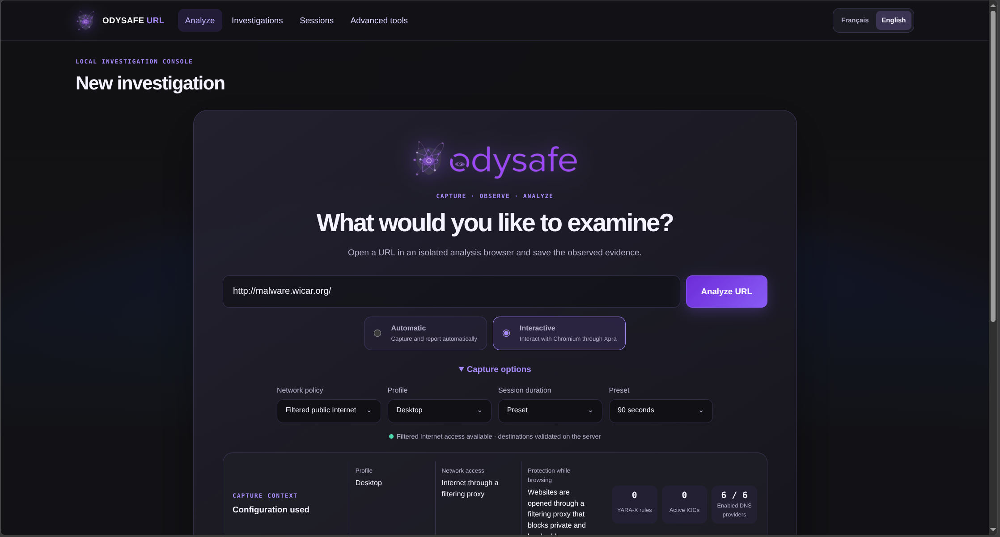
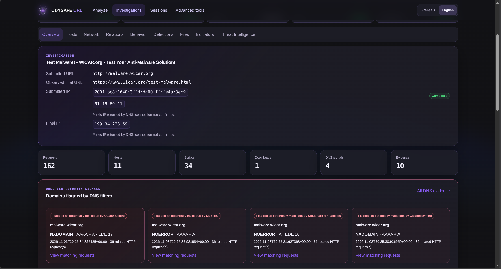
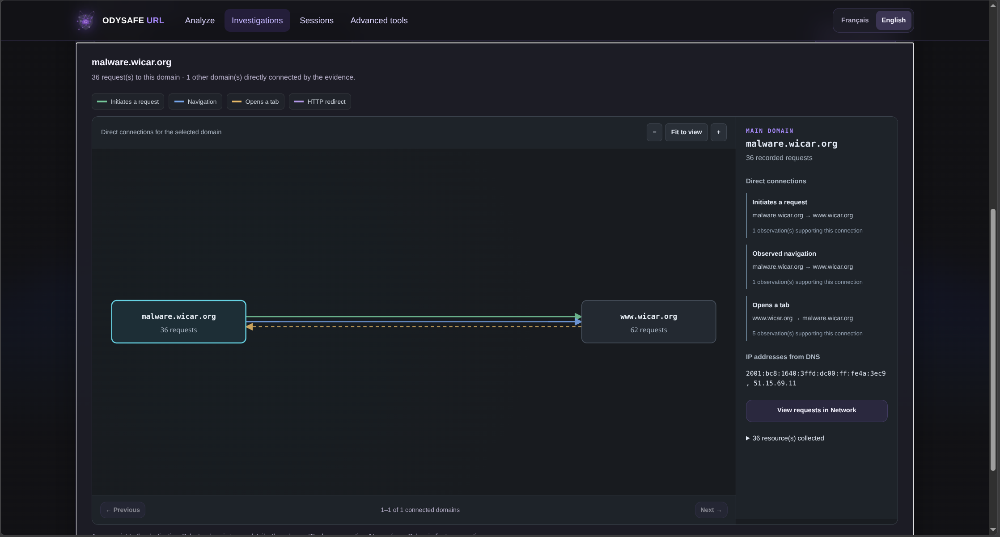
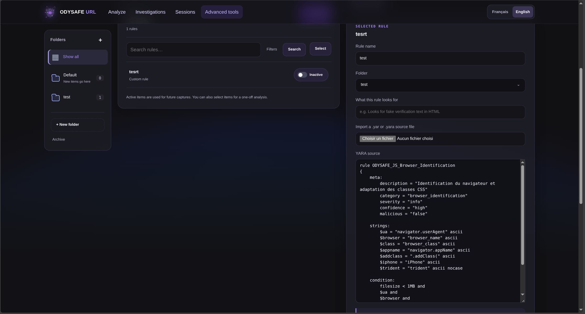
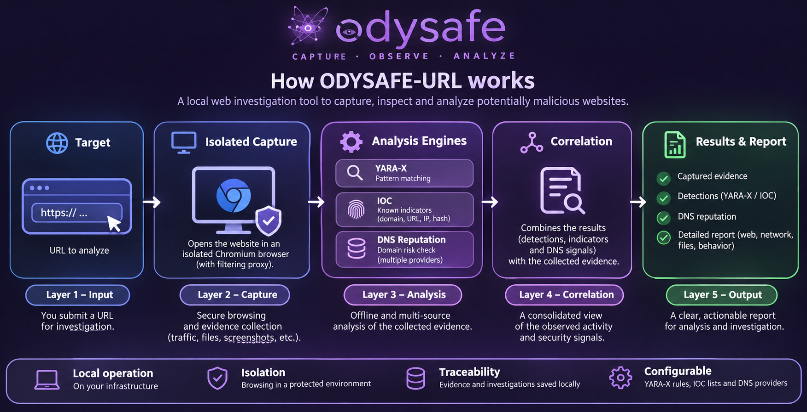

# ODYSAFE-URL

**Capture a website. Understand its activity. Keep the evidence.**

ODYSAFE-URL is a local investigation workspace for examining URLs with Chromium, reviewing network activity and comparing the collected evidence with YARA-X rules, IOC indicators and DNS reputation services. The interface is available in French and English.

This distribution includes the readable application source and Docker build files. The start script builds the required container images on your computer; there is no prebuilt image archive to unpack or load.

[Get started](#get-started) · [Direct Docker startup](#start-directly-with-docker) · [Capture modes](#capture-modes) · [Detection engines](#detection-engines) · [Commands](#everyday-commands) · [Backups](#back-up-and-restore) · [Troubleshooting](#troubleshooting)



## Before you start

| Requirement | What you need |
| --- | --- |
| System | Linux x86_64 / amd64 with AppArmor enabled |
| Containers | Docker Engine, the Docker Compose plugin and Docker Buildx |
| Permissions | An account allowed to run Docker commands |
| First build | Internet access to download base images, system packages, Python dependencies, Chromium and Xpra |
| Browser | A current desktop browser to open the local console |

Use Docker's installation instructions for [Ubuntu](https://docs.docker.com/engine/install/ubuntu/) or [Debian](https://docs.docker.com/engine/install/debian/). Check [AppArmor support](https://docs.docker.com/engine/security/apparmor/) if the start script reports that it is unavailable.

Check your installation:

```sh
docker version
docker compose version
docker buildx version
docker info --format '{{json .SecurityOptions}}'
```

The last command must include `apparmor`. Use a recent Compose plugin supporting `up --wait`; the legacy `docker-compose` command is not used. You do not need Python, Node.js, Chromium or Xpra installed on the host.

This release was verified on Parrot Linux 7.4 x86_64 with Docker Engine 29.9.2 and Docker Compose 5.6.1. Startup, automatic and timed interactive public capture, YARA-X, IOC, automatic DNS, XLSX export, backup and restoration were checked. Ubuntu and Debian are intended hosts when these requirements are met, but every distribution and Docker version has not been tested. Windows, macOS and ARM are not validated for this release.

## Docker access and host permissions

**You do not need to run `sh start.dh` as root.** Run the startup script from your normal user account, which must have permission to use Docker.

Public website captures through the filtering proxy are included in the normal startup. They do not require additional administrator privileges.

Check Docker access from your normal account:

```sh
docker info >/dev/null 2>&1 && echo "Docker access allowed" || echo "Docker access denied"
```

If Docker access is allowed, start the application as shown below. If access is denied, check that Docker is running and ask the system administrator to authorize your account. Do not run the startup script with `sudo` as a workaround.

**Important:** with a conventional rootful Docker Engine, access to Docker generally grants root-equivalent privileges, even without `sudo`. Running this script as a normal user does not make Docker access unprivileged. See [Docker's non-root user documentation](https://docs.docker.com/engine/install/linux-postinstall/#manage-docker-as-a-non-root-user).

## Get started

Open a terminal in the `ODYSAFE-url` directory:

```sh
cd /path/to/ODYSAFE-url
sh start.dh
```

There is one complete installation: automatic and interactive capture, YARA-X, IOC, DNS, reports and exports are all included. No reduced installation or separate feature packages are used. New installations enable filtered public captures and both DNS options by default.

The script checks Docker and AppArmor, creates a private local configuration, builds missing images from `application/`, and starts all services. The first build can take several minutes. Later starts reuse the local images.

Open **[https://localhost:8443](https://localhost:8443)**. A local self-signed HTTPS certificate is created for this installation. Your browser may ask you to accept it; check that you are opening the local address.

### Make your first investigation

1. Open **Analyze** and enter a public HTTP or HTTPS URL.
2. Select **Filtered public Internet** in the capture options.
3. Choose **Automatic** for a hands-off capture, or **Interactive** to use Chromium yourself.
4. For interactive capture, choose a duration before starting.
5. Open the completed investigation to review its report.

Public navigation uses the filtering proxy. Private/LAN addresses, loopback addresses and reserved destinations are blocked on this path.

The **isolated test network** is also available in the same installation. To use its built-in demonstration page, select that network and enter `http://fixture-server:8000/simple.html`. This is a capture policy, not a different installation.

## Start directly with Docker

Use this procedure if you prefer Docker commands or cannot use `start.dh`. It starts the same complete application.

Install **Docker Engine, the Docker Compose plugin and Docker Buildx** first, following the links under [Before you start](#before-you-start). Docker must be running and accessible to your normal user account. The host must be Linux x86_64 / amd64 with AppArmor enabled, and Compose must support `up --wait`. Internet access is required for the first build. Application dependencies, including Python, Chromium and Xpra, are installed inside the container images.

If the startup script failed because one of these requirements is missing, fix that requirement before proceeding: direct Docker commands need it too.

### Prepare the local configuration

Run the following commands in one terminal. They keep an existing configuration and create a private configuration only when none exists. The configuration path is shared with the startup, backup and restore scripts.

```sh
cd /path/to/ODYSAFE-url/application
config_file="${ODYSAFE_INSTALL_CONFIG:-${XDG_DATA_HOME:-$HOME/.local/share}/odysafe-url/installation.env}"

if [ -L "$config_file" ]; then
    echo "Refusing a symbolic link for the configuration file."
elif [ -e "$config_file" ]; then
    echo "Keeping the existing configuration: $config_file"
else
    (
        set -eu
        umask 077
        mkdir -p "$(dirname "$config_file")"
        token=$(od -An -N32 -tx1 /dev/urandom | tr -d ' \n')
        [ "${#token}" -eq 64 ]
        set -C
        printf 'ODYSAFE_INSTALL_TOKEN=%s\nODYSAFE_WEB_PORT=8443\nODYSAFE_XPRA_PORT=14500\nODYSAFE_XPRA_INTERNET_PORT=14501\n' "$token" > "$config_file"
    )
fi
```

If configuration creation fails or a symbolic link is reported, resolve that error before continuing. Keep the generated token private.

### Build and start all services

In the same terminal:

```sh
docker compose --env-file "$config_file" -f compose.json build
docker compose --env-file "$config_file" -f compose.json up -d --no-build --pull never --wait --wait-timeout 240
```

Run the second command only after the build succeeds. Open **[https://localhost:8443](https://localhost:8443)**, or the web port specified in your existing configuration. No additional feature flag is required. On a new installation, both DNS options are enabled as described below.

### Status, logs and shutdown

These commands use the same terminal variables and working directory:

```sh
docker compose --env-file "$config_file" -f compose.json ps -a
docker compose --env-file "$config_file" -f compose.json logs --tail 100
docker compose --env-file "$config_file" -f compose.json stop
```

The last command stops the application and preserves its data. If you open a new terminal, first repeat the `cd` and `config_file=...` lines above. You can also use `sh start.dh` and `sh stop` from the project directory after a direct Docker installation; they reuse the same configuration and data.

## Capture modes

| Mode | What happens |
| --- | --- |
| **Automatic** | Chromium captures the page without an interactive desktop. ODYSAFE then builds the investigation report. |
| **Interactive** | You work inside the analysis browser through Xpra. At the selected deadline, interaction ends automatically and the client returns to Sessions. Evidence and report finalization continue without requiring a click on **Finish**. |

The interactive timer starts when the session enters its running state, rather than after the target page finishes loading. You can finish earlier; reaching the deadline does not offer an extension. Choose enough time before starting. Report preparation can take a little longer than the interaction period.

**Sessions** shows captures in progress and their status. **Investigations** contains completed reports and evidence. Depending on what was collected, a report can include HTML/DOM, screenshots, HTTP requests, hosts, scripts, downloads, browser events and detection results.



### Follow the network activity

Use **Hosts**, **Network** and **Relations** to move from a domain to its requests and observed connections. The relation view distinguishes navigation, request initiation, opened tabs and HTTP redirects; it is an evidence view, not a verdict.



## Detection engines

Open **Advanced tools → Engines**. Each engine has its own workspace.

| Engine | What it examines | How to use it |
| --- | --- | --- |
| **YARA-X** | Available saved HTML, scripts and downloaded files | Create or import rules, organize them in folders, and activate those needed for future captures. No YARA-X rule is preinstalled. |
| **IOC** | Observed indicators such as domains, URLs, IP addresses and available SHA-256 fingerprints | Add indicators with the appropriate type and group them in folders. Supported patterns include `*.ru` for domains and `8.*.8.8` for IPv4 addresses. |
| **DNS** | Domain names checked against selected DNS providers | Choose providers and review their dated observations and interpretation. |

For YARA-X and IOC, you can create and rename folders, move items, select a folder or individual entries, and run a targeted analysis against existing investigations. This reuses saved evidence and does not revisit the website. Active items are used for future captures; a one-off selection does not change their global activation state.

A **SHA-256 IOC** identifies exact captured content, not a website's general reputation. Use the fingerprint of a file or captured resource available in the evidence. A different file, even with the same name, has a different fingerprint if its bytes change.



### DNS defaults in this distribution

Both **Allow external DNS queries** and **Run automatically after each new investigation** are enabled for a new installation. After a capture, domain names can therefore be sent to the enabled providers. Pages and captured files are not sent by the DNS worker.

You can disable either option in the DNS settings. Disabling global authorization blocks external reputation queries; leaving authorization on while disabling automation lets you request checks manually. Existing saved choices are preserved across restarts. An absent or inconclusive DNS signal does not prove a site is safe.

### Export a report

Use the XLSX export actions in **Investigations** or in an individual investigation. The workbook brings together relevant observations and network-flow images. The original evidence remains in local storage.

## Everyday commands

Run these commands from the project directory:

| Task | Command |
| --- | --- |
| Start or resume the complete application | `sh start.dh` |
| Rebuild after changing source files | `sh start.dh --build` |
| Build without starting services | `sh start.dh --build-only` |
| Stop, keeping data | `sh stop` |
| Show service status | `sh tools/status.sh` |
| Show recent logs | `sh tools/logs.sh` |
| Show recent application logs | `sh tools/logs.sh app` |
| Show startup options | `sh start.dh --help` |

`sh start.dh` always starts the complete application, including filtered public website captures. Rebuild and build-only commands are maintenance operations, not reduced installation modes.

Finish ongoing captures before stopping the application or creating a full backup. Editing a source file requires a rebuild before the running containers use the change.

## Configuration and local data

The default private configuration is:

```text
~/.local/share/odysafe-url/installation.env
```

If `XDG_DATA_HOME` is set, its directory replaces `~/.local/share`. The start script prints the actual path. Each computer generates its own control secret; it is not included in the project directory.

You can edit the local file to change `ODYSAFE_WEB_PORT`, `ODYSAFE_XPRA_PORT` or `ODYSAFE_XPRA_INTERNET_PORT`, then run `sh start.dh` again. Public captures through the filtering proxy are always included in this distribution. DNS settings are managed in the application.

Advanced use: `ODYSAFE_INSTALL_CONFIG=/absolute/path/installation.env sh start.dh` selects another configuration file. Use the same environment variable with the other scripts for that installation.

Persistent data lives in named Docker volumes:

| Volume | Contents |
| --- | --- |
| `odysafe-distribution-db` | SQLite catalogue, rules, IOC, settings and results |
| `odysafe-distribution-scans` | Investigation files and saved evidence |
| `odysafe-distribution-certificates` | Local HTTPS certificate and key |
| `odysafe-distribution-backups` | Rolling SQLite snapshots |

Copying this source directory does not copy an existing installation's investigations or secrets. Use a full backup to transfer data. Do not remove these volumes or use `down -v` when you want to keep your investigations.

## Back up and restore

### Create a full backup

Finish any active captures and analyses, then provide a new **absolute file path**:

```sh
sh tools/backup.sh /absolute/path/odysafe-backup.tar.gz
```

The script stops the services for a consistent copy of the four volumes, writes the backup and its SHA-256 checksum, then restarts the services if they were running. An existing destination is not overwritten. Keep the backup and checksum on another disk; the archive contains private evidence and configuration data.

The database service also creates a daily SQLite snapshot and keeps the latest 14. These snapshots are on the same host and do not contain the separate evidence files; they are not a replacement for a full backup.

### Restore onto an empty installation

On the destination computer, build the application **without starting it**:

```sh
sh start.dh --build-only
```

Verify the backup checksum from its containing directory:

```sh
sha256sum -c odysafe-backup.tar.gz.sha256
```

Then restore and start:

```sh
sh tools/restore.sh /absolute/path/odysafe-backup.tar.gz
sh start.dh
```

Services must be stopped and target volumes must be empty. Restoration refuses to overwrite a populated volume. Restore only trusted backups; the script checks archive paths and SQLite integrity.

## What is in this directory?

```text
ODYSAFE-url/
├── README.md
├── start.dh                   Startup, source build and readiness checks
├── stop                       Stop services without deleting data
├── tools/                     Status, logs, backup and restore commands
├── LICENCES/                  Dependency licenses and notices
└── application/
    ├── compose.json           Services, networks, volumes and resource limits
    ├── common.sh              Shared shell helpers
    ├── docker/                Dockerfile, gateways, proxy and Xpra setup
    ├── app/                   Application source, interface and analysis engines
    ├── config/                Capture profiles
    ├── rules/                 Detection resources
    ├── repo/                  Vendored source dependencies and their licenses
    ├── tests/fixtures/        Built-in demonstration pages for isolated mode
    ├── constraints-*.txt      Verified Python dependency versions
    ├── pyproject.toml         Python package and dependency definitions
    └── images/                Screenshots displayed in this README
```

### How the components work together

The local web interface sends capture requests to a controller. Chromium collects evidence in a separate capture service; interactive sessions use Xpra. Public navigation passes through the filtering proxy. The web service has no general Internet egress, and DNS reputation requests use a separate worker. Reports and evidence remain in local Docker volumes.

The diagram below is an overview; `application/compose.json` defines the actual connections and access boundaries.



## Troubleshooting

| Symptom | What to check |
| --- | --- |
| Docker permission error | Run `docker info`. Make sure Docker is running and your account has access before starting ODYSAFE. |
| AppArmor check fails | Enable AppArmor on a supported Linux host; do not remove the security options to bypass the check. |
| First build fails | Read the failing build step. Check Internet access to Docker registries, Debian repositories, PyPI and Xpra, then rerun `sh start.dh --build`. |
| Port already in use | Change the corresponding port in the printed local configuration file, then start again. |
| Public URL rejected | Run `sh start.dh`, select the public Internet policy, and use a public HTTP(S) address. |
| Interactive view unavailable | Check `sh tools/status.sh` and `sh tools/logs.sh capture-controller`; use `capture-controller-internet` for public captures. Ensure the session has not expired and allow opening the interactive tab. |
| Report still finalizing | The interactive deadline ends user access first. Allow time to save evidence and build the report; inspect logs if progress stalls. |
| Disk usage grows | Evidence is retained until you remove investigations. Back up important data and monitor free disk space. |

Container boundaries and network filtering reduce exposure; they are not a guarantee against every exploit. Keep the host, Docker and application dependencies maintained. Rebuilds can download system packages even with Python constraints, so future builds and all future Docker releases cannot be guaranteed indefinitely.

Third-party notices are in `LICENCES/` and `application/THIRD_PARTY_NOTICES.md`. Their attribution and license files are retained with the visible sources.
