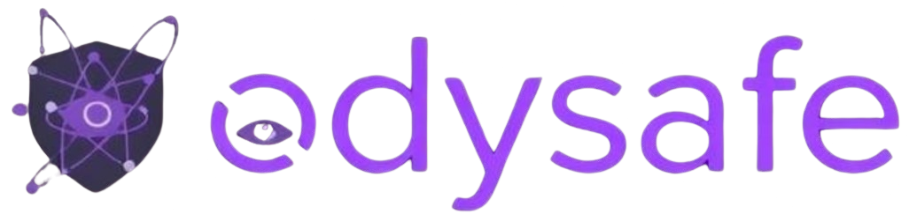
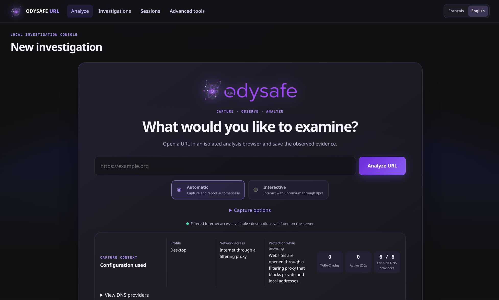
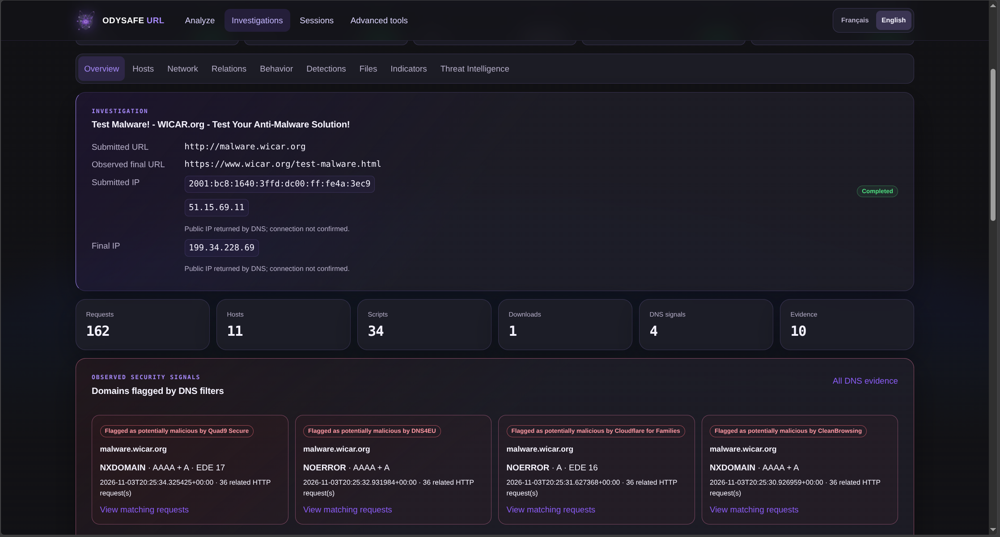
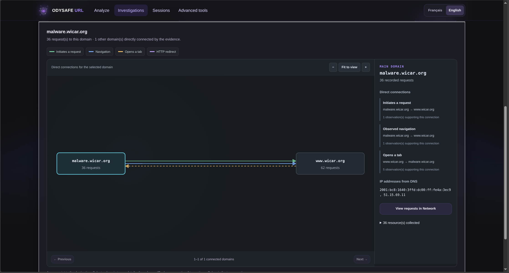

<div align="center">



# ODYSAFE-URL

**Investigate a URL. Observe its behavior. Preserve the evidence.**

`SELF-HOSTED` · `CHROMIUM` · `YARA-X / IOC / DNS` · `EN / FR`

[**Install**](#quick-start) &nbsp; · &nbsp; [Interface](#interface-preview) &nbsp; · &nbsp; [Architecture](#how-it-works) &nbsp; · &nbsp; [DNS](#dns-reputation) &nbsp; · &nbsp; [Commands](#everyday-commands) &nbsp; · &nbsp; [Credits](#acknowledgements)

</div>

> **Linux amd64 · AppArmor · Docker Engine 25+ · Compose 2.20.2+**
>
> Add **Buildx** only when installing from source.
> Python, Chromium and Xpra run inside the containers.
>
> Windows, macOS and ARM are not validated.

A self-hosted workspace for opening URLs inside an analysis browser.

Observe what happens, then review the collected evidence in a local interface.

It is designed for analysts who want to answer a simple question:

**What really happened when this URL was opened?**

<br>

## Why use it

Inspect browser behavior with saved evidence.

| Without ODYSAFE-URL | With ODYSAFE-URL |
|:--|:--|
| You only see the final page | You can inspect requests, hosts, redirects and browser activity |
| Scripts and downloads are easy to miss | Scripts, files and other evidence are preserved for review |
| Detections are spread across separate tools | IOC, YARA-X and DNS findings are reviewed alongside the capture |
| Results are difficult to document | Investigations can be exported as XLSX reports |

<details>
<summary><b>What a suspicious URL can do</b></summary>

A suspicious URL can:

- redirect the browser several times,
- load external scripts,
- contact multiple domains,
- trigger downloads,
- show different behavior than the final page suggests.

ODYSAFE-URL helps you inspect those actions with saved evidence instead of relying only on a final URL, a screenshot, or a reputation score.

</details>

<br>

## What the application does

**Capture → Inspect → Correlate → Export**

<details>
<summary><b>Explore the full feature list</b></summary>

ODYSAFE-URL allows you to:

- submit a URL for analysis,
- open it in a dedicated Chromium capture environment,
- run the capture in automatic or interactive mode,
- review HTTP activity, hosts, relations and evidence,
- compare saved content with YARA-X rules,
- compare observed values with IOC indicators,
- check domains with selected DNS reputation providers,
- export a report while keeping the original evidence locally.

The interface is available in **English** and **French**.

</details>

<br>

## Interface preview

<table>
<tr>
<td width="50%" align="center"><a href="application/images/1.png"></a><br><br><b>01 · Start an investigation</b><br>Choose your URL, browser and capture policy.</td>
<td width="50%" align="center"><a href="application/images/2.png"></a><br><br><b>02 · Review the evidence</b><br>Inspect requests, files and detection signals.</td>
</tr>
<tr>
<td colspan="2" align="center"><a href="application/images/3.png"></a><br><br><b>03 · Follow the network activity</b><br>Explore contacted hosts, redirects and resource relationships.</td>
</tr>
</table>

<p align="center"><sub>Click any preview to view the full image.</sub></p>

<br>

## Typical investigation workflow

1. **Submit** — open **Analyze**, enter a URL and choose a capture policy.

2. **Observe** — keep **Interactive**, or choose **Automatic** for a 9-second observation. Start the capture.

3. **Review** — open the completed entry in **Investigations** and inspect its evidence and detections.

4. **Export** — save a report when needed.

> A missing detection **does not prove that a site is safe**. ODYSAFE supports investigation and analyst judgment.

<br>

## How it works

<p align="center">
  <a href="application/images/High-Level%20Architecture.png">
    
  </a>
</p>

**Capture first. Enrich afterwards.** DNS checks add context to domains recorded during the browser session.

<p align="center"><sub>Click the diagram to view the full image.</sub></p>

---

<a id="quick-start"></a>

<br>

## Quick start · choose an installation method

**Choose one installation method. Both run the same application.**

| **A · From source** | **B · Offline package** |
|:--|:--|
| **I want the source code and to rebuild updates myself.** | **I want the tools already installed, ready to start.** |
| Clone the repository; Docker builds the application. | Download the complete release; Docker imports the images. |
| Needs **Internet + Docker Buildx** for the first build. | Needs **no Buildx or dependency downloads** after obtaining the package. |
| Start command: **`./start.dh`** | Start command: **`./start.dh --offline`** |
| [**↓ Copy the source commands**](#install-source) | [**↓ Copy the offline commands**](#install-offline) |

> **Before either method:** prepare the host with the prerequisites below. Public captures and external DNS checks require Internet access.

### Host preparation (before `git clone` or package extraction)

ODYSAFE-URL is designed for a dedicated Linux amd64/x86_64 machine or virtual machine. The project is installed in the directory where you clone or extract it; Docker stores images and persistent data in its own local Docker storage.

Recommended resources:

| Resource | Minimum | Recommended |
|:--|:--|:--|
| Memory | 4 GB RAM | 8 GB RAM or more |
| Free disk space | 10 GB for a source build | 20 GB for source builds, captures and backups |
| Processor | 2 amd64/vCPU cores | 4 cores or more |

Install the host packages on Debian or Ubuntu:

```bash
sudo apt update
sudo apt install -y ca-certificates curl git docker.io docker-compose-plugin
sudo systemctl enable --now docker
sudo usermod -aG docker "$USER"
```

Apply the Docker group change by signing out and signing in again, or run:

```bash
newgrp docker
docker version
docker compose version
```

For a source installation, also verify Buildx and AppArmor:

```bash
docker buildx version
sudo aa-status
```

If Docker is already installed, do not reinstall it; only verify that the versions satisfy the requirements below.

---

<a id="install-source"></a>

### A · Install from source

**Use this to inspect, customize or rebuild the application from the Git repository.**

Copy these commands into your terminal:

```bash
git clone https://github.com/Odysafe/ODYSAFE-url.git
cd ODYSAFE-url
./start.dh
```

**First start:** Docker builds the missing images and downloads the tools inside them.

**Next starts:** the installed images are reused.

**Requires:** Internet access and Docker Buildx, in addition to the common requirements above.

<details>
<summary><b>↻ Update a source installation</b></summary>

From your existing `ODYSAFE-url` directory:

```bash
./stop
git pull --ff-only
./start.dh --build
```

This retrieves the project changes and rebuilds the images. It does not automatically upgrade every pinned dependency. Back up important evidence before an upgrade.

</details>

---

<a id="install-offline"></a>

### B · Install the offline package

**Use this to start a prepared release without compiling or downloading its dependencies.**

Get these **two files** from the project's [release assets](https://github.com/Odysafe/ODYSAFE-url/releases), and place them in the same directory:

- `odysafe-url-1.0.0-linux-amd64.tar.gz`
- `odysafe-url-1.0.0-linux-amd64.tar.gz.sha256`

Open a terminal in that download directory, then copy:

```bash
sha256sum -c odysafe-url-1.0.0-linux-amd64.tar.gz.sha256
tar -xzf odysafe-url-1.0.0-linux-amd64.tar.gz
cd odysafe-url
./start.dh --offline
```

**First start:** Docker verifies and imports the bundled images, with the tools already installed.

**No host Python installation, Buildx or dependency downloads are needed.**

**Requires:** only the common runtime requirements above.

> Download the **complete release**, not just the Git repository. Use a trusted publisher: a checksum detects corruption, not impersonation.

<details>
<summary><b>↻ Update an offline installation</b></summary>

Stop the current installation with `./stop`. Obtain, verify and extract the new release as above. From the **new release directory**, explicitly import its images and start:

```bash
./start.dh --offline --load-images ./images.tar
```

Your existing secret, certificates and Docker data volumes are reused.

Back up important evidence before an upgrade.

</details>

<br>

<details>
<summary><b>↓ Save disk space after importing the images</b></summary>

From the extracted release directory:

```bash
./start.dh --offline --remove-image-archive
```

After successful startup, this removes **only** the extracted `images.tar` and its checksum.

Docker images, the release inventory, certificates and investigations remain available.

Keep the downloaded release archive if you need to reinstall offline.

</details>

---

### Open the interface

For **either installation method**, wait until the terminal prints `ODYSAFE is ready`, then open:

```text
https://localhost:8443
```

To stop the application later, run `./stop` from its directory. Your data is preserved.

### First start · your own installation

```text
Base images with tools installed
          ↓
Docker creates and starts the containers
          ↓
A unique local secret and TLS certificate are generated
          ↓
https://localhost:8443
```

| When | What happens |
|:--|:--|
| **In the download** | Tools and application code; no investigations, browser sessions, installation secret or private certificate |
| **At first start** | Your installation generates its own secret and TLS certificate |
| **Across restarts** | They persist locally; the certificate is renewed when needed |

> The local self-signed certificate may cause a browser warning on first access.

<br>

## Requirements

| Requirement | Details |
|:--|:--|
| Operating system | Linux x86_64 / amd64 with AppArmor enabled |
| Containers | Docker Engine **25+**, Docker Compose plugin **2.20.2+** |
| Permissions | A regular user allowed to run Docker commands |
| Docker Buildx | Required only for a source build |
| Internet access | Required for source installation, public captures and external DNS checks; unnecessary for offline installation |
| Browser | A modern desktop browser for the local interface |
| Installation location | Any local directory owned by the installing user; avoid network shares and removable media |
| Memory | 4 GB minimum; 8 GB or more recommended for interactive captures |
| Disk space | At least 10 GB free for source builds; 20 GB recommended for evidence and backups |

<details>
<summary><b>Check your Docker setup</b></summary>

```bash
docker version
docker compose version
docker info --format '{{json .SecurityOptions}}'
```

</details>

<br>

## Deployment · VM & remote access

For security and operational reasons, **we strongly recommend installing ODYSAFE-URL inside a dedicated Linux virtual machine (VM)** rather than directly on a physical workstation.

<details>
<summary><b>Why use a VM, and how to connect remotely</b></summary>

Running ODYSAFE-URL in a virtual machine provides an additional isolation layer when investigating potentially malicious URLs. It also simplifies deployment, maintenance, backups and centralized access.

This setup allows authorized users to access the ODYSAFE-URL web interface remotely from other computers without installing the application on each workstation.

By default, the interface is available locally at:

```text
https://localhost:8443
```

For remote access, users can establish a secure SSH tunnel to the virtual machine:

```bash
ssh -N -L 8443:127.0.0.1:8443 user@VM_IP_ADDRESS
```

Once connected, they can open `https://localhost:8443` in their browser.

**Security recommendations:**

- Use a dedicated Linux VM with AppArmor enabled.
- Restrict remote access to authorized users through SSH or VPN.
- Keep the application isolated from sensitive internal networks.
- Do not expose port 8443 directly to the public Internet.
- Regularly update the virtual machine and Docker environment.

**Note:** Remote access does not imply full multi-user support. The current release supports one active capture at a time and does not provide independent user accounts or isolated concurrent sessions.

</details>

<br>

## Capture modes

| Mode | Description | Best use |
|:--|:--|:--|
| **Interactive · default** | Interact with Chromium through Xpra during the selected time window | Pages that require manual actions |
| **Automatic · 9 seconds by default** | Observe the page, then save evidence and finish analysis automatically | Fast initial review |

<details>
<summary><b>Understand capture timing</b></summary>

The automatic duration starts when browser navigation begins. Browser startup, evidence finalization and enrichment add processing time.

Choose a longer observation in capture options when needed. Interactive sessions have their own duration: **90 seconds by default**.

</details>

<br>

## Detection engines

| Engine | Purpose |
|:--|:--|
| YARA-X | Search saved HTML, scripts and files with your own rules |
| IOC | Compare observed domains, URLs, IPs and file hashes with your indicators |
| DNS | Check domains against selected DNS security providers |

These engines provide **signals**, not absolute conclusions.

<br>

## DNS reputation

**DNS checks run after capture.** They add domain-level context to the recorded evidence.

| Scope | Details |
|:--|:--|
| **Input** | Public domain names observed during the investigation |
| **Queries** | `A` and `AAAA` records over DNS over HTTPS |
| **Boundary** | Checks do not inspect full URL paths or replace the browser network policy |

<details>
<summary><b>Six providers · configured profiles and interpretation</b></summary>

| Provider | Profile configured in ODYSAFE | How ODYSAFE uses the response |
|:--|:--|:--|
| **Quad9 Secure** | Secure · `9.9.9.9` | Threat-filtering signals, including supported Extended DNS Errors |
| **Cloudflare for Families** | Malware · `1.1.1.2` | Malware/phishing profile; interprets the `0.0.0.0` filtering response |
| **DNS4EU** | Protective · `86.54.11.1` | Protective profile; interprets documented warning-page addresses |
| **CleanBrowsing** | Security Filter · `185.228.168.9` | Security profile; compares an `NXDOMAIN` response with reference resolution |
| **Control D** | Free Malware p1 · `76.76.2.1` | Limited interpretation: keeps responses for review without treating a negative answer alone as a threat |
| **Cisco OpenDNS** | Public · `208.67.222.222` | Limited interpretation: keeps responses for review; this is not a configured enterprise Umbrella deployment |

These are the profiles actually configured in the [provider registry](application/app/dns/providers.py): adult, family and advertising filters are not used as substitutes for security signals. Provider selection and custom public resolvers are available in **Engines → DNS**.

</details>

<br>

<details>
<summary><b>How to read DNS results</b></summary>

| Response | Interpretation |
|:--|:--|
| Domain resolves | Does not prove safety |
| Error or timeout | Inconclusive |
| Generic negative answer | Does not prove malware |
| Providers disagree | Compare their policies and recorded evidence |

Correlate DNS responses with requests, saved content and YARA-X/IOC findings.

</details>

> **Privacy:** enabled checks disclose queried domain names to the selected providers.
>
> Review DNS settings for sensitive names. Results stay with the investigation; their reuse period is configurable (**24 hours by default**).

<br>

## Data and reports

**Investigations stay in local Docker volumes. Reports can be exported as XLSX.**

Stopping the application preserves its volumes, installed images and configuration.

<details>
<summary><b>What is stored</b></summary>

Persistent data includes:

- the investigation catalog,
- evidence files,
- YARA-X rules,
- IOC indicators,
- DNS results,
- local application settings.

</details>

<br>

<details>
<summary><b>Where the installation configuration lives</b></summary>

The configuration and secret stay **outside the repository**:

```text
${XDG_DATA_HOME:-$HOME/.local/share}/odysafe-url/installation.env
```

Override the path with `ODYSAFE_INSTALL_CONFIG` when needed.

This file is persistent configuration, not a disposable cache. `stop` keeps it, along with the Docker images and volumes.

</details>

<br>

## Everyday commands

| Task | Command |
|:--|:--|
| Start or resume; build missing images in a source checkout | `sh start.dh` |
| Start with existing/bundled images, without building | `sh start.dh --offline` |
| Remove the imported archive after successful first start | `sh start.dh --offline --remove-image-archive` |
| Import images without starting services | `sh start.dh --prepare-only` |
| Rebuild from source (Internet + Buildx) | `sh start.dh --build` |
| Build from source without starting | `sh start.dh --build-only` |
| Stop services | `sh stop` |
| Show status | `sh tools/status.sh` |
| Show logs | `sh tools/logs.sh` |

<br>

## Backup and restore

### Backup

```bash
sh tools/backup.sh /absolute/path/odysafe-backup.tar.gz
```

<details>
<summary><b>Restore a backup</b></summary>

```bash
sh start.dh --prepare-only
sha256sum -c odysafe-backup.tar.gz.sha256
sh tools/restore.sh /absolute/path/odysafe-backup.tar.gz
sh start.dh
```

</details>

<br>

## Troubleshooting

| Problem | Check |
|:--|:--|
| Docker permission denied | Verify `docker info` works as your regular user |
| AppArmor missing | Enable AppArmor on a supported host |
| Missing image | Use the complete offline release including `images.tar` and `images.tar.sha256` |
| Port already in use | Change the configured port and restart |
| Interactive capture not opening | Check service status and logs |
| Internal Server Error | Read `sh tools/logs.sh`; confirm that the images belong to the installed release |
| Disk usage increasing | Review stored evidence and backup important data |

<details>
<summary><b>How startup, updates and shutdown behave</b></summary>

- **Offline upgrade:** stop the application, extract the new release and run `sh start.dh --load-images ./images.tar`.

- **Source update:** explicitly run `sh start.dh --build` after changing the source files.

- **Normal start:** existing images are reused. A source checkout builds missing images; an offline bundle never silently falls back to building.

- **Readiness and shutdown:** startup waits for health checks. Shutdown forwards termination signals and allows capture finalization within the existing 45-second grace period.

</details>

<br>

## Security notes

- Use ODYSAFE-URL only in an authorized investigation context.
- Public captures go through a filtering proxy.
- Private, loopback and reserved destinations are blocked on the public route.
- Captured evidence and backups may contain sensitive data.
- DNS checks may disclose queried domains to the selected providers when enabled.
- Container isolation reduces risk but does not eliminate it.

<br>

## Repository layout

<details>
<summary><b>Explore the source tree</b></summary>

```text
ODYSAFE-url/
├── README.md
├── start.dh
├── stop
├── tools/
├── LICENCES/
└── application/
    ├── compose.json
    ├── common.sh
    ├── docker/
    ├── app/
    ├── config/
    ├── rules/
    ├── repo/
    ├── tests/fixtures/
    ├── constraints-*.txt
    └── pyproject.toml
```

</details>

<br>

## Validation and maintenance

This release targets **one local installation per analyst**, with a loopback-only web console and one active capture at a time. Publishing the application for many installations is different from operating a shared multi-user service.

<details>
<summary><b>Test coverage and commands</b></summary>

Coverage includes:

- page rendering in both languages and invalid forms;
- capture defaults, Chromium capture and finalization on shutdown;
- detection workflows and XLSX/ZIP exports;
- bounded session history and repeated SQLite backups.

From `application/`, with the application dependencies installed:

```bash
python -B -m unittest discover -s tests -p 'test_*.py'
```

Browser tests additionally require the browser image, `ODYSAFE_TEST_BROWSER=1`, the fixture network and writable ephemeral runtime directories. They are skipped when these requirements are not enabled.

</details>

<br>

<details>
<summary><b>Backup retention and ongoing maintenance</b></summary>

**Retention:** the latest **14 daily SQLite backups** are kept.

**Evidence files:** use the full backup command above to include them.

**Operations:** monitor service status, free disk space and backup success. Test restoration before relying on a deployment.

**Updates:** rebuild and validate changed dependencies before rollout.

These checks are local regressions, not a large-scale load test or a guarantee against future defects.

</details>

<br>

## Offline release · maintainers

<details>
<summary><b>Build, audit and package a distribution</b></summary>

Build and validate the application images first. The packaging tool requires Python 3.11+ and Docker on the maintainer's machine only:

```bash
sh start.dh --build-only
python -B tools/package-offline.py dist/odysafe-url-1.0.0-linux-amd64.tar.gz
```

**Audit**

The packager inspects each image and compares its application files with this source checkout. It exports images, never running containers or Docker volumes.

**Included**

Public source, required licenses, five pristine images, checksums and a distribution inventory.

**Size reduction**

Shared layers are stored once, gzip compression is maximized and the unused Chromium headless-shell variant is omitted. Both capture modes use full Chromium.

**Privacy and cleanup**

Tar ownership metadata is neutral. Git history, local configuration, credentials, investigations, backups, caches and development tool directories are excluded. Packaging intermediates are removed when the command finishes.

**Publication**

`dist/` is excluded from Git. Publish the reviewed bundle and its checksum as release assets; no registry is used.

Installed images and runtime volumes are necessary persistent application data. The maintainer's personal installation is not supplied: each user generates their own secret and certificate.

</details>

<br>

## Acknowledgements

Thank you to the maintainers and communities behind the tools that make ODYSAFE-URL possible.

<details>
<summary><b>Capture, analysis and browser access</b></summary>

| Project / tool | Contribution |
|:--|:--|
| [PlaywrightCapture](https://github.com/Lookyloo/PlaywrightCapture) | Browser capture engine |
| [Playwright](https://playwright.dev/python/) and [Chromium](https://www.chromium.org/) | Browser automation and analysis browser |
| [har2tree](https://github.com/Lookyloo/har2tree) | HAR parsing and request relationships |
| [Lookyloo](https://github.com/Lookyloo/lookyloo) | Resource icons and adapted tree presentation |
| [YARA-X](https://github.com/VirusTotal/yara-x) | Content matching with YARA rules |
| [Xpra](https://xpra.org/) | Remote interactive browser display |
| [Squid](https://www.squid-cache.org/) | Filtering proxy for public captures |

</details>

<br>

<details>
<summary><b>Interface, reports and application libraries</b></summary>

| Project / tool | Contribution |
|:--|:--|
| [FastAPI](https://fastapi.tiangolo.com/), [Starlette](https://www.starlette.io/), [Uvicorn](https://www.uvicorn.org/) | Local web application and HTTP server |
| [Jinja](https://jinja.palletsprojects.com/) and [htmx](https://htmx.org/) | HTML templates and interface interactions |
| [dnspython](https://www.dnspython.org/) and [HTTPX](https://www.python-httpx.org/) | DNS and HTTP transports |
| [XlsxWriter](https://xlsxwriter.readthedocs.io/) and [Pillow](https://python-pillow.org/) | XLSX reports and image processing |
| [Python](https://www.python.org/) and [SQLite](https://sqlite.org/) | Application runtime and local database |
| ODYSAFE-CTI | Reused visual assets and adapted interface styles |

</details>

<br>

<details>
<summary><b>Containers, system components and DNS providers</b></summary>

| Project / tool | Contribution |
|:--|:--|
| [Docker Engine, Compose and Buildx](https://www.docker.com/) | Container builds, isolation and service orchestration |
| [Debian](https://www.debian.org/), [AppArmor](https://apparmor.net/) and [OpenSSL](https://www.openssl.org/) | Container system packages, confinement and local TLS certificates |
| [Quad9](https://www.quad9.net/), [Cloudflare](https://developers.cloudflare.com/1.1.1.1/setup/#1111-for-families), [DNS4EU](https://www.joindns4.eu/for-public), [CleanBrowsing](https://cleanbrowsing.org/), [Control D](https://controld.com/), [Cisco OpenDNS](https://www.opendns.com/) | External DNS provider signals |

</details>

Third-party licenses and notices are retained in [LICENCES/](LICENCES/) and [THIRD_PARTY_NOTICES.md](application/THIRD_PARTY_NOTICES.md). Python and Debian packages retain their own dependency metadata and license notices.
