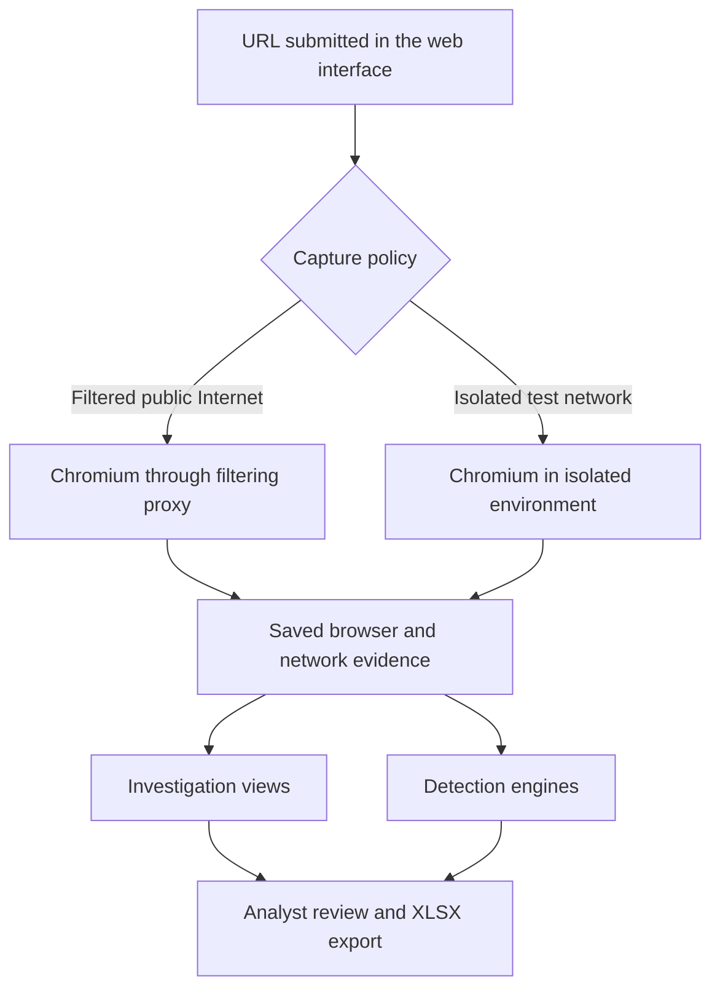

# ODYSAFE-URL

## Investigate a URL and keep the evidence

ODYSAFE-URL is a self-hosted investigation workspace for opening URLs inside an analysis browser, observing what happens, and reviewing the collected evidence in a local interface.

It is designed for analysts who want to answer a simple question:

**What really happened when this URL was opened?**

---

## Why use it

A suspicious URL can:

- redirect the browser several times,
- load external scripts,
- contact multiple domains,
- trigger downloads,
- show different behavior than the final page suggests.

ODYSAFE-URL helps you inspect those actions with saved evidence instead of relying only on a final URL, a screenshot, or a reputation score.

| Without ODYSAFE-URL | With ODYSAFE-URL |
|:--|:--|
| You only see the final page | You can inspect requests, hosts, redirects and browser activity |
| Scripts and downloads are easy to miss | Scripts, files and other evidence are preserved for review |
| Detections are spread across separate tools | IOC, YARA-X and DNS findings are reviewed alongside the capture |
| Results are difficult to document | Investigations can be exported as XLSX reports |

---

## What the application does

ODYSAFE-URL allows you to:

- submit a URL for analysis,
- open it in a dedicated Chromium capture environment,
- run the capture in automatic or interactive mode,
- review HTTP activity, hosts, relations and evidence,
- compare saved content with YARA-X rules,
- compare observed values with IOC indicators,
- check domains with selected DNS reputation providers,
- export a report while keeping the original evidence locally.

The interface is available in **English** and **French**.

---

## Example of the interface

### Start a new investigation

<p align="center">
  <a href="application/images/1.png">
    
  </a>
</p>

This page is used to:

- enter the target URL,
- choose the capture mode,
- choose the network policy,
- start the analysis.

### Review the result

<p align="center">
  <a href="application/images/2.png">
    
  </a>
</p>

The result pages let you review:

- the submitted and final URLs,
- observed IP information,
- the number of requests, hosts, scripts and downloads,
- DNS alerts,
- saved evidence,
- YARA-X, IOC and DNS analysis results.

### Follow the network activity

<p align="center">
  <a href="application/images/3.png">
    
  </a>
</p>

You can move from a host to its requests and investigate the observed relationships between pages, requests, redirects and browser actions.

---

## Typical investigation workflow

1. Open **Analyze**.
2. Enter a URL.
3. Choose a capture policy.
4. Choose **Automatic** or **Interactive** mode.
5. Start the capture.
6. Open the completed result in **Investigations**.
7. Review the evidence and detections.
8. Export the report if needed.

ODYSAFE-URL is an **investigation tool**, not a final safety verdict. A missing detection does **not** prove that a site is safe.

---

## How it works



---

## Quick start

### 1. Clone the repository

```bash
git clone https://github.com/Odysafe/ODYSAFE-url.git
cd ODYSAFE-url
```

### 2. Start the application

```bash
sh start.dh
```

The startup script:

- checks the host requirements,
- creates local configuration,
- builds missing Docker images from the included source,
- starts the full application.

### 3. Open the interface

```text
https://localhost:8443
```

A self-signed certificate is generated locally, so your browser may show a warning the first time.

---

## Requirements

| Requirement | Details |
|:--|:--|
| Operating system | Linux x86_64 / amd64 with AppArmor enabled |
| Containers | Docker Engine, Docker Compose plugin and Docker Buildx |
| Permissions | A regular user allowed to run Docker commands |
| Internet access | Needed for the first build to download dependencies |
| Browser | A modern desktop browser for the local interface |

Check your system:

```bash
docker version
docker compose version
docker buildx version
docker info --format '{{json .SecurityOptions}}'
```

---

## Capture modes

| Mode | Description | Best use |
|:--|:--|:--|
| Automatic | Chromium runs the capture without analyst interaction | Fast initial review |
| Interactive | You interact with Chromium through Xpra during a selected time window | Pages that require manual actions |

---

## Detection engines

| Engine | Purpose |
|:--|:--|
| YARA-X | Search saved HTML, scripts and files with your own rules |
| IOC | Compare observed domains, URLs, IPs and file hashes with your indicators |
| DNS | Check domains against selected DNS security providers |

These engines provide **signals**, not absolute conclusions.

---

## Data and reports

ODYSAFE-URL stores data in Docker volumes and can export investigations to XLSX.

Persistent data includes:

- the investigation catalog,
- evidence files,
- YARA-X rules,
- IOC indicators,
- DNS results,
- local application settings.

---

## Everyday commands

| Task | Command |
|:--|:--|
| Start or resume | `sh start.dh` |
| Rebuild after changes | `sh start.dh --build` |
| Build only | `sh start.dh --build-only` |
| Stop services | `sh stop` |
| Show status | `sh tools/status.sh` |
| Show logs | `sh tools/logs.sh` |

---

## Backup and restore

### Backup

```bash
sh tools/backup.sh /absolute/path/odysafe-backup.tar.gz
```

### Restore

```bash
sh start.dh --build-only
sha256sum -c odysafe-backup.tar.gz.sha256
sh tools/restore.sh /absolute/path/odysafe-backup.tar.gz
sh start.dh
```

---

## Troubleshooting

| Problem | Check |
|:--|:--|
| Docker permission denied | Verify `docker info` works as your regular user |
| AppArmor missing | Enable AppArmor on a supported host |
| First build fails | Check logs and retry `sh start.dh --build` |
| Port already in use | Change the configured port and restart |
| Interactive capture not opening | Check service status and logs |
| Disk usage increasing | Review stored evidence and backup important data |

---

## Security notes

- Use ODYSAFE-URL only in an authorized investigation context.
- Public captures go through a filtering proxy.
- Private, loopback and reserved destinations are blocked on the public route.
- Captured evidence and backups may contain sensitive data.
- DNS checks may disclose queried domains to the selected providers when enabled.
- Container isolation reduces risk but does not eliminate it.

---

## Repository layout

```text
ODYSAFE-url/
├── README.md
├── start.dh
├── stop
├── tools/
├── LICENCES/
└── application/
    ├── compose.json
    ├── common.sh
    ├── docker/
    ├── app/
    ├── config/
    ├── rules/
    ├── repo/
    ├── tests/fixtures/
    ├── constraints-*.txt
    └── pyproject.toml
```

---

## Summary

ODYSAFE-URL is a local investigation platform for analyzing URLs with Chromium, reviewing network and browser evidence, and correlating the findings with YARA-X, IOC and DNS-based signals.

If you need a self-hosted tool to inspect what a suspicious link actually does, this project is built for that purpose.
